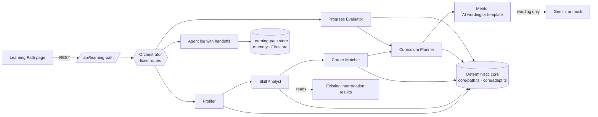
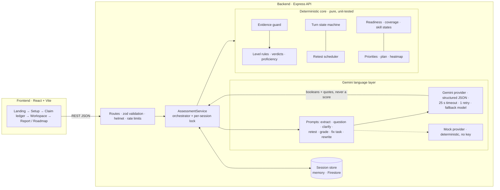

# UNBLUFF


## SkillForge: AI learning path platform

SkillForge is a learning-path layer on top of UNBLUFF for **students and for organizations and
universities that want to see what a cohort can actually do**. A learner says what they know and which
career they want; specialised agents find the gaps, plan a roadmap with free resources, and **re-plan when
the learner changes goal or struggles on an assessment**. Placement preparation (below) is one use case of
the same evidence engine, not the whole product.

| What the problem statement asks | How SkillForge answers it | Where |
|---|---|---|
| User profile: skills, certifications, projects, career goals | A profile card. Skills, project skills and the topics a recognised certification covers (curated list, `data/learning/certifications.json`) count as **declared** (never above 40%) until verified; a certification with no rule is kept and shows "no skills mapped". Names it cannot match are listed back, not dropped. | `/learning-path`, `backend/src/agents/profiler.ts` |
| Skill analysis, missing skills | Per role skill: `gap = weight × (1 − mastery)`, with the missing topics named (JavaScript, React, Node.js…). Unverified skills are marked, with a **Verify this skill** link into the existing interrogation flow. | `core/path.ts` `computeGaps` |
| Career matching | Match % for the target role and the top 3 other roles, from weighted effective mastery. | `agents/careerMatcher.ts` |
| Learning recommendations (courses, tutorials, practice) | Each roadmap step carries up to 3 curated free resources (one course or tutorial, one exercise), ordered by prerequisites. The list is hand-curated static data, never generated. | `data/learning/` |
| Progress tracking | Roadmap % weighted by step gap, mastery bars per skill, next best step. | `core/path.ts` `progressSummary` |
| An AI mentor that updates recommendations from performance | Below 60%: a remedial step on the missing prerequisite is inserted and dependent steps pause. 60–84%: done, flagged to review. 85%+: done and the next step advances. Every change comes with a "why this changed" reason. | `core/adapt.ts` |
| Adjust when the career goal changes | The roadmap is rebuilt for the new role; what the learner already knows carries over; the diff shows **kept / added / removed / reordered** with reasons. | `adaptOnGoalChange` |
| **Multiple specialised agents that collaborate** | Six agents behind a fixed routing table, with a visible **Agent Activity** log that shows each action, who decided it, and the handoffs. | `backend/src/agents/` |

### The agents

| Agent | Does | Decides by |
|---|---|---|
| Profiler | Normalizes the profile; resolves free-text skills to topics | rules |
| Skill Analyst | Credits verified interrogation results to topics (demo-model results are never counted); records an assessment result | rules |
| Career Matcher | Scores the target role and every other role; finds the gaps | rules |
| Curriculum Planner | Builds the roadmap and attaches curated resources; rebuilds it on a goal change | rules |
| Progress Evaluator | Applies a graded result to the roadmap and reports progress | rules |
| Mentor | Writes a short coaching message from the facts above | **AI wording only**, with a template fallback |

Routing is a constant table of event → agents (`ROUTES` in `agents/orchestrator.ts`): a new profile, a
submitted assessment, or a goal change. No model chooses an agent.

### Deterministic core, language-only AI

Every decision (gaps, ordering, mastery, adaptation, routing) is pure TypeScript in `backend/src/core`,
with unit tests. The model never picks, ranks, scores or routes: it only phrases the mentor message, from a
small facts object, and the UI says whether a message came from the AI or from a template. With
`LLM_MODE=mock` (no key) the whole app works and the template is always used. A result that comes from the
**Simulation** slider is labelled Simulation everywhere it appears, and a "real" result is read on the
server from the student's own graded interrogations (the client cannot supply that score).



### Three-minute demo (no API key needed)

1. Open **Build my learning path**, press **Load sample student** (Python, SQL, HTML → Full Stack), then **Build my learning path**. Gaps show JavaScript, React and Node.js; the roadmap follows prerequisites with resources; a match % is shown.
2. In **Assessment**, choose JavaScript, leave the slider at 40 and **Apply simulated score** (labelled Simulation). A remedial step appears, React and Node.js pause, the reason is shown, and the log reads Progress Evaluator → Curriculum Planner → Mentor.
3. Set the slider to 90 and apply again: the paused steps unblock and progress rises.
4. Under **Change career goal** pick Data Analyst: Python and SQL are kept, statistics and visualization steps are added, React and Node.js are removed, each with a reason.
5. Reload the page: the state is still there.

### Run SkillForge locally in mock mode

No API key and no Firebase project needed. Sign-in is a clearly labelled demo identity (`AUTH_MODE=mock` on the
backend, `VITE_AUTH_MODE=mock` on the frontend; both are refused in production builds).

```bash
# terminal 1
cd backend && npm ci && LLM_MODE=mock AUTH_MODE=mock STORE=memory PORT=8090 CORS_ORIGIN=http://localhost:5173 npm run dev
# terminal 2
cd frontend && npm ci && printf 'VITE_API_URL=http://localhost:8090\nVITE_AUTH_MODE=mock\n' > .env && npm run dev
```

Open http://localhost:5173/learning-path. On Windows PowerShell set the variables first
(`$env:LLM_MODE="mock"; $env:AUTH_MODE="mock"; $env:STORE="memory"; $env:PORT="8090"; $env:CORS_ORIGIN="http://localhost:5173"`).
For the real model set `LLM_MODE=live` with `GEMINI_API_KEY` (and optionally `GEMINI_MODEL`); only the mentor's wording changes.
### Built on UNBLUFF; added for this hackathon

UNBLUFF (claim interrogation, evidence-guarded grading, placement planner, mentor, careers, learn
content, 7 weighted roles) already existed. Added for SkillForge: the learning-path core (`core/path.ts`,
`core/adapt.ts`), the topic and prerequisite graph and curated resources (`backend/data/learning`), the six
agents and orchestrator (`backend/src/agents`), the learning-path store, service and routes, the Learning
Path page, and tests for all of it. The API additions are appended to [`CONTRACT.md`](CONTRACT.md) and the
choices are in [`DECISIONS.md`](DECISIONS.md) ("SkillForge learning path", "SkillForge agents").

Limits, stated plainly: roles score broad skills, so JavaScript, React and Node.js are *topics* mapped under
the Full Stack skills (`web_frontend`, `rest_apis`) rather than separate role skills. A certification adds declared (never verified)
skills only when it matches a curated rule; generic cloud certifications are deliberately unmapped. The resource list is curated by hand and its links were checked once when it
was written, not continuously. There is no separate persistent learner-profile record yet: a profile lives
with each learning path. Simulated scores exist only to show how the roadmap adapts.
## UNBLUFF: the evidence engine

**Your resume says you're ready. Let's prove it.** UNBLUFF is a mock placement interviewer that
checks every claim on a student's resume against a target role and shows, with evidence from their
own answers, what they can defend and what they need to fix.

## Problem statement → UNBLUFF

| The student needs to know… | How UNBLUFF answers it |
|---|---|
| **What to prepare** | Pick a role → the resume becomes a list of verifiable claims mapped to the role's weighted skills. **Blind spots** list required skills the student never claimed. |
| **Where they stand** | Each claim is interrogated on 3 levels and ends **Defended / Shaky / Bluff / Honest gap**. The report shows readiness (0–100), role coverage, a resume heatmap, and per-skill states, each backed by verbatim quotes. |
| **What to improve** | Top-3 **priorities** ranked by `weight × (1 − proficiency)`, a **root cause** (the most fundamental missing prerequisite) per weak claim, and honest resume rewrites. |
| **How to prepare** | A targeted **fix task** (explanation + exercise) per weak claim, a **7-day plan**, a 4-week roadmap preview, and a **delayed retest** that proves the improvement. |

## What makes it different

- **Claim-based, 3-level interrogation.** Every resume claim is probed at **L1 What** (what *you*
  built), **L2 How** (the mechanism) and **L3 Why** (when *not* to use it, defending it against an
  alternative). One follow-up is allowed per level when an answer is too vague.
- **Root-cause diagnosis.** Each role skill lists 3–5 prerequisites. Grading names the most
  fundamental one the answer is missing. Code keeps it only if it's exactly on the list, and it costs
  no extra LLM call.
- **Delayed, interleaved, fresh-scenario retest.** Opening a fix task schedules a retest that unlocks
  only after **2 other claims** are completed. The retest is a *new* scenario question, never a repeat.
  `interleaved_claims` records the real gap.
- **Deterministic core with an evidence guard.** The LLM only returns per-criterion booleans plus
  quotes. A criterion counts only if its quote is a **verbatim substring** of the student's answer.
  Pass/fail, verdicts, proficiency, readiness, coverage, priorities and scheduling are pure,
  unit-tested code, so the same answers always get the same score.

## Architecture



The full API contract (types, endpoints, errors, display mapping, mock report) is in
[`CONTRACT.md`](CONTRACT.md). Design decisions and trade-offs are in [`DECISIONS.md`](DECISIONS.md).

## Google services

| Service | Status | Where |
|---|---|---|
| **Gemini API** via the official **Google Gen AI SDK** (`@google/genai`) | ✅ Live when `LLM_MODE=live` | `backend/src/llm/gemini.ts`: structured output (`responseJsonSchema`), thinking level, timeout, primary `gemini-3.1-flash-lite` + fallback `gemini-3.6-flash` on 429/5xx |
| **Cloud Run** + **Cloud Build** + **Artifact Registry** | ⚙️ Implemented, not deployed (needs billing) | `backend/Dockerfile`, `backend/scripts/deploy.sh` (`gcloud run deploy --source backend`) |
| **Firestore** | ⚙️ Implemented, not deployed | `backend/src/store/firestoreStore.ts` (`STORE=firestore`), unit-tested with a mocked client |
| **Secret Manager** | ⚙️ Implemented, not deployed | `deploy.sh` pipes the key in via stdin and mounts it with `--set-secrets` |
| **Cloud Logging** format | ✅ In code | `backend/src/logger.ts`: pino logs carry Cloud Logging `severity`; every LLM call logs prompt, model, latency, validity |
| **Firebase Hosting** | ⚙️ Configured, not deployed | `firebase.json` / `.firebaserc` serve `frontend/dist` as an SPA |

## Tech stack

- **Backend:** Node 20, TypeScript (strict), Express 5, zod, `@google/genai`, pino, helmet,
  express-rate-limit, `@google-cloud/firestore`; tests with Vitest + Supertest.
- **Frontend:** React 18, TypeScript (strict), Vite, Tailwind CSS, React Router, lucide-react,
  pdf.js (loaded only when a PDF is chosen); tests with Vitest + Testing Library.
- **Tooling:** ESLint (typescript-eslint, jsx-a11y), Prettier, GitHub Actions CI, Docker, Render Blueprint.

## Run locally

Backend on `:8090` in mock mode (deterministic, **no API key needed**):

```bash
cd backend && npm ci && LLM_MODE=mock STORE=memory PORT=8090 CORS_ORIGIN=http://localhost:5173 npm run dev
```

Frontend (`frontend/.env` contains `VITE_API_URL=http://localhost:8090`, as in `.env.example`):

```bash
cd frontend && npm ci && cp .env.example .env && npm run dev
```

Then open http://localhost:5173. Mock mode is for tests and offline UI work: the AI Mentor page labels it "Mock mode" and `GET /api/health` reports `llm_mode`, and a production server refuses it unless `ALLOW_MOCK_LLM=true`. For live Gemini, set `LLM_MODE=live`, `GEMINI_API_KEY` and
`GEMINI_MODEL` in `backend/.env` (see `backend/.env.example`).

**How to demo (3 min):** View Demo Report → open a heatmap line (evidence drawer) → Audit My Readiness
→ *Teach me* → paste 3 resume lines → answer claim 1 "I don't know" (honest gap + root cause + fix
task) → answer the next two → "Welcome back — a new scenario" → pass the retest → the report shows
"Verified after 2 other concepts".

## Testing

```bash
cd backend  && npm run lint && npm run typecheck && npm test
cd frontend && npm run lint && npm run typecheck && npm test && npm run build
```

Latest run (14 November 2026): **backend 1,283 tests** (84 files) and **frontend 400 tests** (30 files), all passing, with lint and
typecheck clean. The 51 Firestore/Auth emulator tests (12 files, `npm run test:emulator`, needs Java) were last run on 22 October 2026 and were not re-run for the SkillForge changes. The backend's
deterministic core (`src/core`) is at 100% line coverage, and CI enforces ≥ 95%.

- Backend: level rules, evidence guard, turn state machine, retest scheduler, scoring, plan,
  heatmap, report, Gemini provider (retry, fallback, timeout, with a fake client), Firestore store
  (mocked), prompts, contract drift guards, and full HTTP flows (errors, security, efficiency,
  prepare-mode learning loop, long single-line resumes).
- Frontend: API error mapping, Setup sends `mode`, ledger delete → confirm payload, clarify tag,
  teach-now fix card, retest banner, report verdict labels, evidence drawer keyboard flow, wake-up
  gate, roadmap builder.
- `frontend/scripts/e2e-check.mjs` runs the whole loop against a running backend with the UI's exact payloads.
- `backend/scripts/grade_check.ts` is a live Gemini grading check (strong / wrong / "I don't know" /
  vague / prompt injection / off-topic), 6/6 on both models.

## Security, accessibility, efficiency

**Security**
- Strict zod request schemas (unknown keys rejected) and a 100 kB body limit.
- helmet headers, CORS allow-list, global + LLM-route rate limits.
- Errors use the contract shape, never stack traces.
- Keys only from env / Secret Manager, redacted from logs.
- Prompt-injection defense: student text is wrapped in tags it can't close, and the evidence guard means a fooled model still can't pass a criterion.

**Accessibility**
- One `h1` per page, landmarks, labelled inputs, jsx-a11y lint.
- Focus moves to each new question; `aria-live` for questions and verdicts.
- `role="status"` loaders, `role="alert"` errors.
- Modal evidence drawer with focus trap, Esc and focus return.
- Verdicts always shown as label + icon + color (WCAG-AA colors, CONTRACT.md §6).
- Respects `prefers-reduced-motion`.

**Efficiency**
- Report-time LLM output is cached per claim (a report refetch = 0 LLM calls, tested), with at most 2 concurrent calls, stopping on the first failure.
- A per-session lock stops double submits.
- Resuming an open question is free.
- Workspace, Report and Roadmap are code-split, and pdf.js loads on demand.
- The fallback model plus a quota cooldown keep the free tier usable.

## Roadmap

- Company-specific practice (questions tuned to a target company's stack)
- Full mock interview mode
- Aptitude rounds
- Activity tracking across sessions
- Placement-cell dashboard for cohorts
